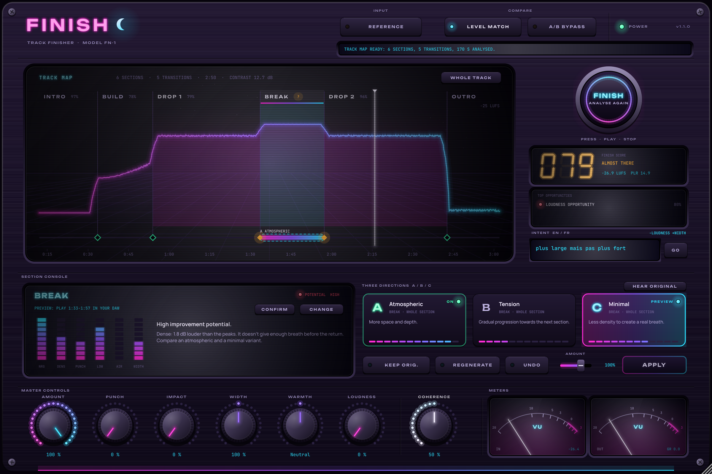
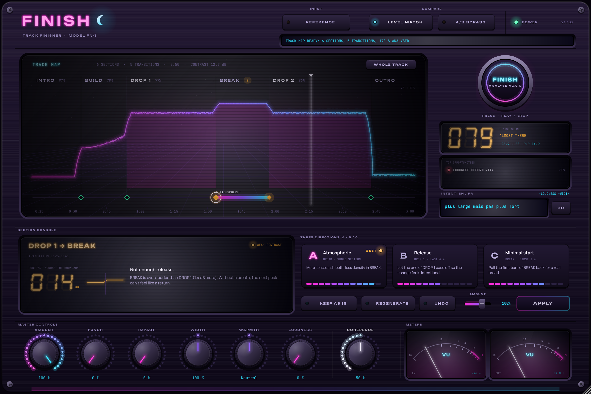
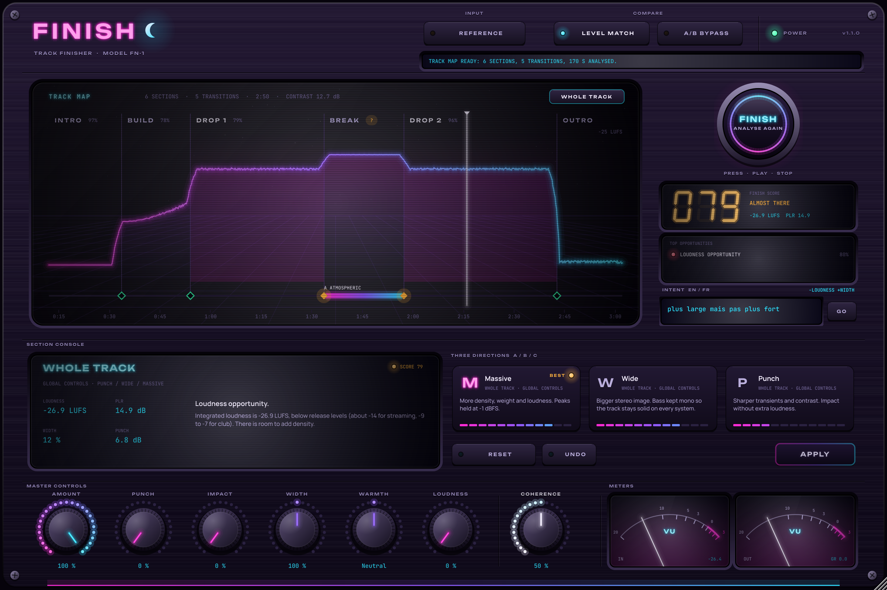
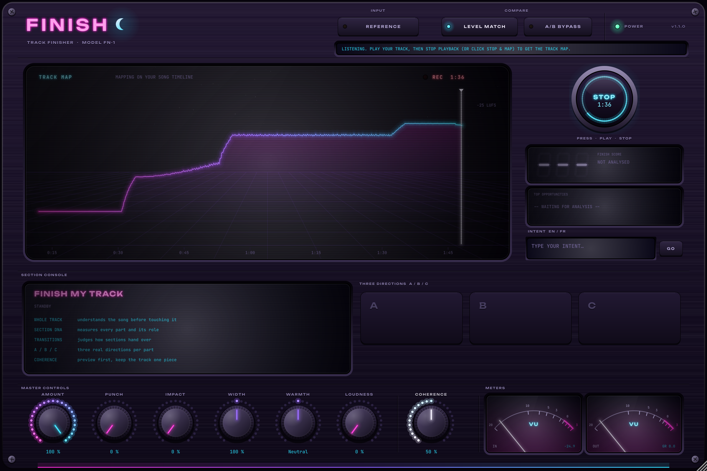
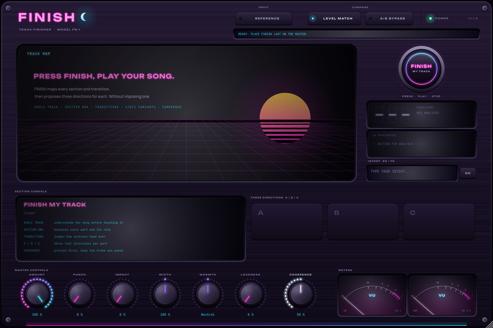

# FINISH 1.2 — Don't mix forever. Finish the music.

FINISH est un plugin VST3 (et AU sur Mac) à placer en dernier sur le master, dans **FL Studio**, **Ableton Live** ou tout DAW VST3.

**FINISH MY TRACK** analyse le morceau comme une œuvre entière. Il repère ce qui peut être amélioré dans chaque section et entre les sections, puis propose trois directions pour chaque endroit. Il ne t'impose aucune direction et peut aussi dire qu'une partie fonctionne déjà.



## FINISH MY TRACK

| Capacité | Ce que fait FINISH | Modules |
|---|---|---|
| **Whole Track Intelligence** | Construit une TRACK MAP sur la timeline de ton DAW : courbe d'énergie, sections (INTRO, VERSE, CHORUS, BUILD, DROP, BREAK, BRIDGE, OUTRO), score. Les sections sont détectées par le volume *et* par la texture (changement de batterie, de basse, de spectre ou de largeur). | `SectionDetector` |
| **Confiance** | Chaque section a un niveau de confiance. Quand FINISH hésite (« BREAK ? or DROP »), il le dit et te demande de confirmer. Clic droit pour changer le type, glisser une frontière pour déplacer un marqueur. | `SectionDetector`, `TrackMapView` |
| **Section DNA** | Mesure chaque section (énergie, densité, punch, grave, air, largeur, pente d'énergie) et lui donne un rôle : installer l'ambiance, créer l'attente, premier pic, nouveau sommet, respiration, conclusion. | `SectionFeatureAnalyzer` |
| **Transition Intelligence** | Juge chaque frontière (BUILD → DROP, DROP → BREAK, BREAK → DROP 2, DROP → OUTRO…) en comparant la fin d'une section au début de la suivante. Peut conclure « Works, no change needed ». | `TransitionAnalyzer` |
| **Diagnostic en contexte** | Ne juge jamais une section isolément. Exemple : « DROP 2 — Already powerful… Work on the BREAK → DROP 2 transition rather than the drop itself. » | `SectionDiagnosisEngine` |
| **Adaptive Variants** | Trois directions réellement différentes par section et par transition, selon le rôle. Exemples : Break = Atmospheric, Tension, Minimal ; Drop 2 = Bigger, Evolved, Contrast ; Build → Drop = Build, Transition, Drop. REGENERATE en propose trois autres. Les variantes risquées sont refusées avec une explication. | `VariantGenerator`, `VariantRanker` |
| **Coherence & Preview** | Cliquer une carte = PREVIEW en direct pendant que le DAW joue. Autres contrôles : AMOUNT, KEEP ORIGINAL (section intacte), APPLY, UNDO. Le potard COHERENCE ramène les sections vers un son commun et FINISH signale les sauts trop brusques. | `TrackEngine`, `SectionPlan` |

### Fonctionnement technique
- Les modifications sont **automatisées dans le temps** : le plugin lit la position de lecture du DAW et applique, à chaque bloc audio, la direction choisie pour la section en cours. Les entrées et sorties de chaque modification sont lissées sur 120 ms, pour éviter les clics.
- Le thread audio n'alloue rien et ne se bloque jamais. Il récupère un nouveau plan par *try-lock* ; l'analyse et les propositions se font hors du thread audio.
- Les changements de niveau voulus (dips, silences avant le drop, fades) passent **après** l'égalisation de niveau A/B : elle ne les annule donc pas.
- La carte, les corrections, les variantes appliquées et l'intent sont **sauvegardés avec le projet**.
- **Limite V1** : sur le master, un VST3 ne reçoit que le mix stéréo. FINISH ne modifie pas les pistes individuelles ; il traite le signal reçu, section par section.

### Le reste du plugin
Analyse globale (LUFS, PLR, largeur, corrélation, basse stéréo, punch), FINISH SCORE, intent en français ou en anglais, morceau de référence, stratégies globales PUNCH / WIDE / MASSIVE et chaîne DSP réversible : transitoires, glue, chaleur, largeur avec basse mono, densité, limiteur à -1 dBFS et A/B à volume égal.

## Façade « synthwave hardware » (1.2)
FINISH se présente comme une vraie machine, le modèle FN-1.
- **Châssis** : métal anodisé brossé, vis, liseré néon.
- **Logo** : en tube néon.
- **Bouton FINISH** : gros bouton rond lumineux de type arcade. Son anneau tourne pendant l'écoute.
- **Track Map** : sur un **écran cathodique** avec lignes de balayage, sol quadrillé synthwave et soleil couchant au repos.
- **Section Console** : un écran LCD (Section DNA en échelles de LED, verdict) et **trois pads A/B/C rétroéclairés**.
- **Touches** : boutons en caoutchouc avec LED (KEEP, REGENERATE, UNDO, LEVEL MATCH, A/B) et une touche APPLY illuminée.
- **Score** : sur un **afficheur 7 segments**.
- **Potards** : capuchon métal strié et **couronne de LED** dégradée magenta → cyan. COHERENCE a une couronne blanche.
- **Mesure** : deux **VU-mètres rétroéclairés à aiguille** (IN / OUT), avec la réduction de gain affichée sur le VU OUT.

Polices intégrées, sous licence libre OFL : Unbounded, Manrope et JetBrains Mono. La fenêtre est redimensionnable de 60 % à 160 %.

| | |
|---|---|
|  |  |
|  |  |

## Obtenir le plugin compilé
- **GitHub (recommandé)** : pousse ce dossier sur un dépôt GitHub. L'onglet Actions compile Windows et macOS, lance les tests et pluginval, puis fournit `FINISH-Windows-VST3.zip` et `FINISH-macOS-VST3-AU.zip`. Un tag `v1.1.0` publie une Release.
- **Sur ta machine** : `build_windows.bat` (Visual Studio 2022, CMake, Git) ou `sh build_mac.sh` (Xcode, CMake, Git).

Voir `INSTALL_FR.txt` pour l'installation et l'utilisation dans FL Studio et Ableton.

## Tests
```
cmake -S . -B build -DFINISH_BUILD_TESTS=ON
cmake --build build --config Release --target FinishTests
build/FinishTests_artefacts/Release/FinishTests                     # 123 vérifications
build/FinishTests_artefacts/Release/FinishTests --snapshot ui.png   # captures de l'interface
```

Les tests couvrent notamment :
- la carte alignée sur la timeline du DAW et la détection des 6 sections ;
- un break dense signalé comme incertain, et les transitions faibles autour de lui ;
- un drop 2 identique au drop 1, avec la recommandation de travailler la transition ;
- une modification de section qui ne change rien en dehors de sa section (différence nulle) ;
- Keep Original qui laisse l'audio intact, preview, regenerate, undo des modifications et des corrections de structure ;
- la cohérence, et la sauvegarde puis le rechargement du plan ;
- tout ce que couvrait la V1 : DSP, niveau, fréquences d'échantillonnage, intent, état.

Le VST3 passe **pluginval au niveau 10**.

## Limites connues
- Les seuils sont calibrés sur des mixes de synthèse. Il faudra les affiner sur de vrais morceaux et selon les genres (voir `Tests/QA_MATRIX.md`).
- Pour entendre une variante en preview, il faut rejouer le passage dans le DAW (un plugin ne peut pas déplacer la tête de lecture).
- Interface en anglais (l'intent comprend le français).
- Pas de signature de code commerciale ni de licence (voir `Installer/README.md`).
